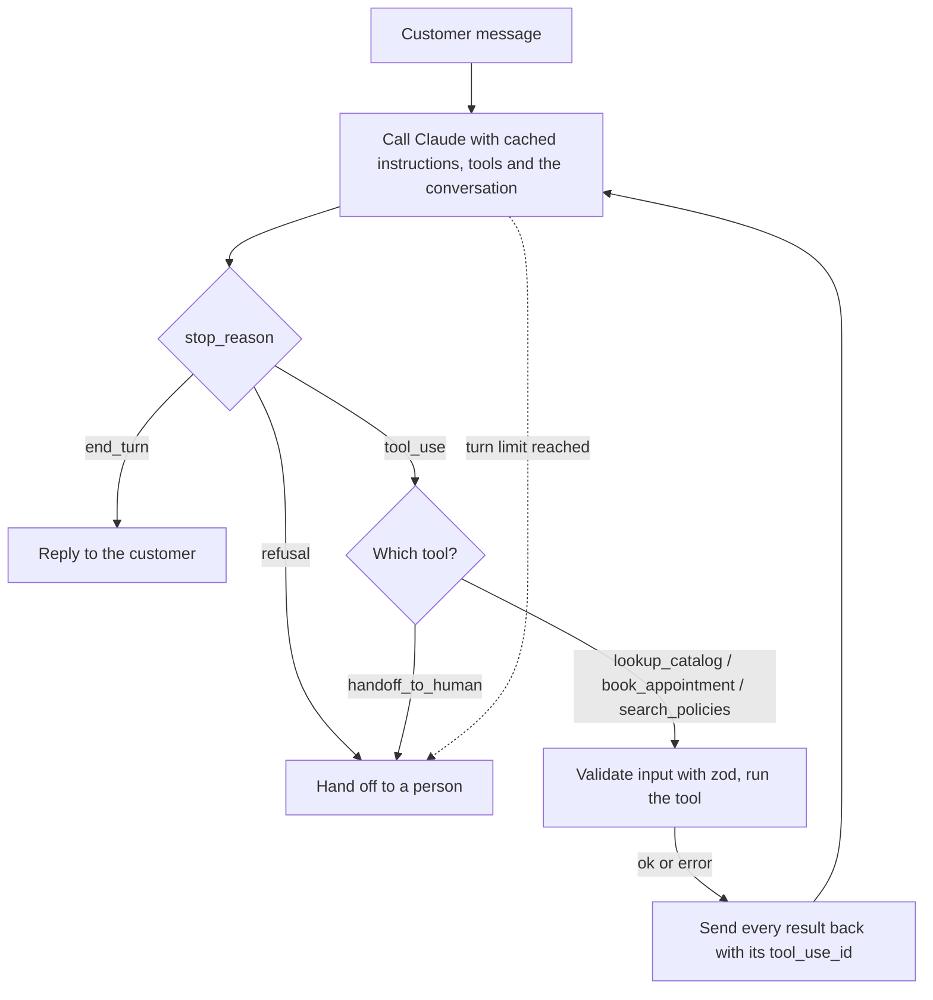

# agent-ops

A WhatsApp-style sales and support agent for a small running store, built in public with TypeScript, the Claude API, tool use, retrieval over pgvector and prompt caching. The store, Northside Running Co., is fictional.

## What works today

Today the agent can look up the catalog, book appointments and hand the customer off to a person. The store's policies live in a database: when a customer asks about shipping, returns or payments, Claude calls a search tool that finds the policy passages closest in meaning to the question, and Claude answers from those passages and cites them. It hands off to a person when the customer asks for a human, is upset, wants an exception the policies don't allow, or asks something the catalog, the policies and the bookings can't answer.

How I know it works: 40 automated tests run against a fake Claude with scripted replies, so they need no API key. They cover tool calls and their ids, bad tool inputs, the turn limit, handoffs, the booking rules, a prompt that stays identical between calls so it can be cached, the cost of every turn, and one test with the real embedding model that proves search by meaning: "how much does delivery cost?" finds the shipping costs section, though the question never says "shipping".

## How it works



- **Tools** (`src/tools`): `lookup_catalog`, `book_appointment` (store rules live in code: hours, Sundays, last slot, double booking), `search_policies` and `handoff_to_human`. Every input is validated with zod before the tool runs; a bad input goes back to Claude as an error it can recover from.
- **Retrieval** (`src/rag`): each policy section is one chunk, embedded locally with all-MiniLM-L6-v2 (384 dimensions, no key) and stored in pgvector, running in-process with PGlite. Search is `ORDER BY embedding <=> $1 LIMIT $2`. Claude reads the text of the nearest passages, never the vectors.
- **Cost** (`src/agent/cost.ts`): every model call is logged with its four token counters and its cost. Tools and instructions are cached, so after the first call they're read at a twentieth of the input price.
- **Model**: `claude-opus-5-5`, with server-side refusal fallbacks. If the whole chain refuses, the customer goes to a person.

## Evals

Retrieval eval over 30 customer questions, 10 of them written by me in the words a customer would use ("Is the shipping measured in days or weeks?", "Can I pay with crypto?"). Full table in [docs/evals/retrieval.md](docs/evals/retrieval.md); CI fails if hit@3 drops.

| Retriever | Right section first | Right section in the 3 Claude reads |
|---|---|---|
| Local embeddings | 26/28 (93%) | 28/28 (100%) |
| Keyword baseline | 8/28 (29%) | 17/28 (61%) |

Two labels were widened after review, because both "Return window" and "How to return" answer "Can I return one item?"; the note is in the cases file. Two questions the policies can't answer ("Is Maryland available for shipping?") aren't scored here: the right behavior is a handoff, which the behavior eval will check.

### Behavior eval

The whole agent on real conversations, scored by four automatic checks: right tool, correct handoff, citation present, no invented prices. Run on 14 of the 36 conversations with gpt-4.1-mini through the OpenAI adapter (the account used allows 50 requests a day per model). Report: [docs/evals/behavior-gpt-4.1-mini.md](docs/evals/behavior-gpt-4.1-mini.md).

| Check | Passed |
|---|---|
| Right tool | 11/11 |
| Correct handoff | 13/14 |
| Citation present | 8/8 |
| No invented prices | 12/12 |

The failure is the interesting part: asked "Is Maryland available for shipping?", the agent answered "Yes, we do ship to Maryland", though the policies never list destinations. gpt-4o did the same in an earlier run.

## Run it

```bash
npm install
npm test                                              # 40 tests, no API key needed
npm run eval:retrieval                                # retrieval eval, writes docs/evals/retrieval.md
npx tsx --env-file=.env scripts/eval-behavior.ts gpt-4.1-mini   # behavior eval, needs OPENAI_API_KEY
npm run transcript -- dan-01                          # read one eval conversation step by step
open evals/reports/*.html                             # both evals as readable pages, with transcripts
npm run rag -- "can I return shoes I already ran in?" # see retrieval step by step
npm run chat                                          # live chat, needs your own ANTHROPIC_API_KEY
```

## Status

A learning project built in public over two afternoons. Design decisions, each with the alternative I rejected, are in [docs/DECISIONS.md](docs/DECISIONS.md); what's next is in [docs/ROADMAP.md](docs/ROADMAP.md).
